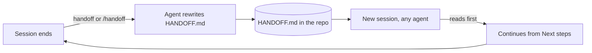

<div align="center">

# 🔁 Handoff

**Pick up every AI coding session exactly where the last one stopped — with any agent.**

One small file carries the goal, the state, and the next steps from session to session.

[](SKILL.md)
[](LICENSE)
[](workflows/)
[](.github/CONTRIBUTING.md)

[Explore the skill](SKILL.md) · [Handoff format](references/handoff-format.md) · [Contribute](.github/CONTRIBUTING.md) · [Get help](.github/SUPPORT.md) · [Security](SECURITY.md)

</div>

---

## Every new session starts from zero

Close a session and the context goes with it. The next one — tomorrow, in another agent, or after the credits run out — has to rediscover the goal, re-read the repository, and re-learn the constraints you already stated: the branch never to touch, the design that must not change, the command that only works with a special flag. Work gets repeated, and decisions get quietly reversed.

**Handoff** is an agent skill that fixes this with one file, `HANDOFF.md`, at the root of your repository. At the end of a session the agent rewrites it; at the start of the next, any agent reads it first and continues from the first open step. It works the same in Claude Code, Codex, Gemini CLI, Antigravity, Grok, or any agent that can read a Markdown file.

> Hold only what the next session needs, point to everything else, and never carry secrets.

## ⚙️ What the skill brings to your agent

| Capability | What it means in practice |
| :--- | :--- |
| **Instant continuation** | A new session reads one short file and starts the first next step, without re-reading the whole repository. |
| **Constraints that stick** | Decisions and standing rules you gave in one session are recorded, so the next agent keeps them. |
| **Agent-neutral** | Plain Markdown at the repository root, plus a rule for `AGENTS.md`, `CLAUDE.md` or `GEMINI.md`. No lock-in to one tool. |
| **Always current** | The file is rewritten, never appended. Finished work drops out; the length stays under about 80 lines. |
| **Safe by default** | Secrets, tokens, one-time codes and personal data are never recorded. |
| **Version-controlled** | The handoff is committed with the work when commits are allowed, so its history travels with the repository. |

## 🧩 How it works



`HANDOFF.md` always has the same five sections, defined in [the handoff format](references/handoff-format.md):

| Section | Holds |
| :--- | :--- |
| **Goal right now** | The current aim and the standing constraints. |
| **Where things stand** | Branch, what is finished, the last checks actually run. |
| **Next steps** | A numbered list, each naming the file or command to start from. |
| **Open questions** | Decisions waiting on someone. |
| **Gotchas** | Traps a fresh session would otherwise hit. |

## Three workflows

| Workflow | When | Result |
| :--- | :--- | :--- |
| [Save a handoff](workflows/save-handoff.md) | End of a session, when you ask | `HANDOFF.md` rewritten and committed when allowed |
| [Resume a handoff](workflows/resume-handoff.md) | Start of a session | Work continues from the first open step |
| [Bootstrap a repository](workflows/bootstrap-repository.md) | A repository without a handoff | `HANDOFF.md` plus a rule in its agent instructions |

## 📥 Get started

Keep [`SKILL.md`](SKILL.md), `references/`, `workflows/`, `assets/` and `scripts/` together so the skill can find its resources.

### Install once for every agent

Clone one shared copy and link it into each agent. Full details, including where each agent looks, are in [agent setup](references/agent-setup.md).

```sh
git clone https://github.com/YourAKShaw/handoff.git ~/.agents/skills/handoff
ln -sfn ~/.agents/skills/handoff ~/.claude/skills/handoff
mkdir -p ~/.gemini/skills ~/.gemini/antigravity/skills
ln -sfn ~/.agents/skills/handoff ~/.gemini/skills/handoff
ln -sfn ~/.agents/skills/handoff ~/.gemini/antigravity/skills/handoff
```

Then append the global rule from [the agent instructions snippet](assets/agent-instructions-snippet.md) to `~/.claude/CLAUDE.md`, `~/.codex/AGENTS.md` and `~/.gemini/GEMINI.md`, so agents read `HANDOFF.md` first even where they do not load skills.

### Claude Code only

```sh
mkdir -p ~/.claude/skills
git clone https://github.com/YourAKShaw/handoff.git ~/.claude/skills/handoff
```

Type `/` in Claude Code and look for `handoff`.

### Skills CLI

```sh
npx skills add YourAKShaw/handoff --global
```

See the [Skills CLI documentation](https://github.com/vercel-labs/skills#readme) for supported agents and options.

### Claude — upload a ZIP

1. [Download the repository ZIP](https://github.com/YourAKShaw/handoff/archive/refs/heads/main.zip), extract it, and rename the folder to `handoff`.
2. Compress that folder into `handoff.zip`, with `SKILL.md` directly inside `handoff/`.
3. In Claude, open **Customize → Skills → + → Create skill → Upload a skill** and upload the ZIP.

## 💬 Put it to work

At the end of a session:

```text
/handoff
```

or, in agents without slash commands:

```text
Update the handoff.
```

At the start of the next session, in any agent:

```text
Continue.
```

To set up a repository that has never had a handoff:

```text
Set this repository up for handoffs.
```

## 📂 Inside the repository

```text
handoff/
├── SKILL.md                         # Entry point: routing and rules
├── references/
│   ├── handoff-format.md            # The five sections, order, and limits
│   ├── what-to-capture.md           # Include, exclude, keep current
│   └── agent-setup.md               # Global install for each agent
├── workflows/
│   ├── save-handoff.md
│   ├── resume-handoff.md
│   └── bootstrap-repository.md
├── assets/
│   ├── handoff-template.md          # HANDOFF.md skeleton
│   └── agent-instructions-snippet.md
└── scripts/
    ├── validate-skill.py            # Offline package validator (Python 3.9+)
    ├── validate-skill.sh
    ├── validate-skill.ps1
    └── test_validate_skill.py       # Validator regression suite
```

## Validate the package

```sh
python3 scripts/validate-skill.py
python3 scripts/test_validate_skill.py
```

The validator uses only the Python standard library. It checks the manifest, required files, local links and anchors, and that every resource is reachable from `SKILL.md`. It does not measure agent behavior.

## 🤝 Contributing and support

See [CONTRIBUTING](.github/CONTRIBUTING.md) to propose changes, [SUPPORT](.github/SUPPORT.md) for help, and [SECURITY](SECURITY.md) to report a vulnerability privately.

## License

[MIT](LICENSE)
